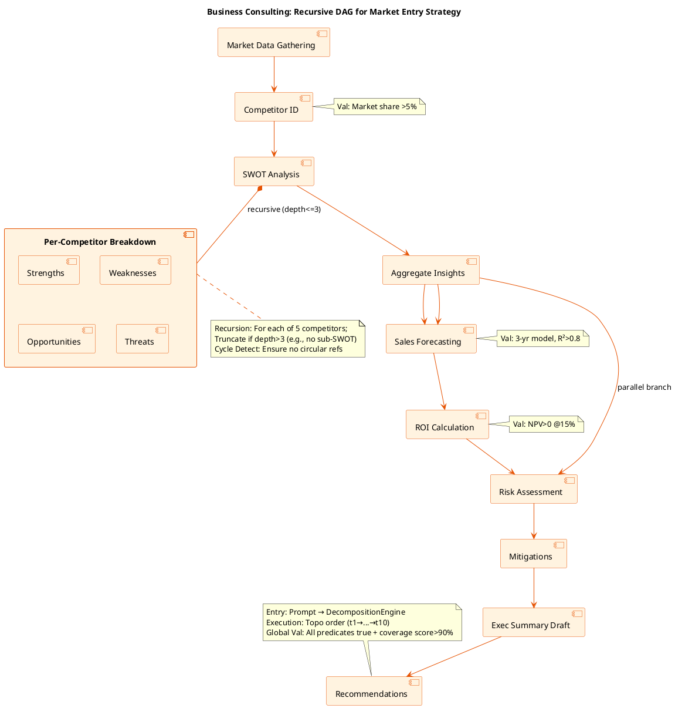

# 01-Architecture-Logic-Overview.md

# Task-Splitting: Architecture Logic Overview

**Version**: 1.0  
**Date**: November 10, 2025  
**Author**: Grok (xAI)  

## Introduction

This document provides an overview of the logical architecture for task decomposition in the Task-Splitting project, emphasizing how the DAG-based model handles complexity in domain-specific scenarios. The core logic—hierarchical predicate decomposition, topological execution, and validation—scales to intricate workflows by allowing recursion (bounded by `max_depth=3`) and rich subtask attributes (e.g., CSS selectors for UI actions, quantitative checks for business metrics).

We illustrate this with two non-proprietary examples:
1. **Frontend Web E2E Testing**: A complex, multi-step automation scenario involving UI interactions, assertions, and error handling—mirroring real E2E test suites (e.g., for Cypress/Selenium).
2. **Business Consulting/Management**: A strategic analysis workflow, with subtasks for research, modeling, and decision-making—typical in consulting engagements (e.g., McKinsey-style frameworks).

Each example includes:
- A sample prompt.
- Expected decomposition (high-level subtasks).
- A PlantUML diagram visualizing the DAG (copy-paste into PlantUML renderer for visualization).

These demonstrate how the system enforces **coverage** (full prompt fulfillment), **atomicity** (verifiable steps), and **orderliness** (dependencies), while integrating domain-specific validations (e.g., HTTP responses in testing, KPI thresholds in consulting).

## 1. Frontend Web E2E Testing Scenario

### Context
In E2E testing, tasks involve simulating user journeys across a web app: navigation, form interactions, API validations, and UI assertions. Complexity arises from branching (e.g., error paths), parallelism (concurrent tests), and recursion (e.g., "test cart" → "add item" → "update qty").

**Sample Prompt**:  
"Run a full E2E test on demoshop.local: User logs in with valid/invalid creds, browses categories, adds 3 random products to cart, updates quantities, applies a 10% coupon, proceeds to checkout, selects PayPal, completes payment, and verifies order success page with screenshot. Handle errors like 'out of stock' by retrying."

**Expected Decomposition** (Top-Level DAG, ~12 subtasks; recursion on "Browse & Add Products"):
- t1: Navigate to login (deps: []; val: HTTP 200, login form visible).
- t2: Test valid login (deps: [1]; val: Dashboard accessible).
- t3: Test invalid login (parallel to t2; val: Error toast shown).
- t4: Browse categories (deps: [2]; val: Category list loaded).
- t5: Add 3 random products (deps: [4]; recursive: t5.1 Search, t5.2 Select, t5.3 Add; val: Cart count=3).
- t6: Update quantities (deps: [5]; val: Total recalculated).
- t7: Apply coupon (deps: [6]; val: Discount applied, 10% off).
- t8: Proceed to checkout (deps: [7]; val: Shipping form visible).
- t9: Select PayPal (deps: [8]; val: Redirect initiated).
- t10: Complete payment (deps: [9]; val: Success redirect).
- t11: Verify order (deps: [10]; val: Order ID displayed, screenshot saved).
- t12: Handle errors (overarching; triggered on failures; val: Log captured, retry if <3).

**PlantUML: Activity Diagram for E2E Testing DAG**  
(This shows the topological flow with recursion and parallelism. Render at plantuml.com.)

```puml
@startuml E2E Testing Task Decomposition DAG
!define RECTANGLE class

title E2E Testing: Recursive DAG for DemoShop Workflow

skinparam activity {
  BackgroundColor #E1F5FE
  BorderColor #01579B
  ArrowColor #01579B
}

start

:Navigate to Login\n(t1: GET /login; Val: HTTP 200);

fork
  :Valid Login\n(t2: POST creds; Val: Token received);
fork again
  :Invalid Login\n(t3: POST bad creds; Val: 401 Error toast);
end fork

:Branch to Dashboard\n(deps: t2);

: Browse Categories\n(t4: Click #nav-menu; Val: .category-list visible);

note right: Recursive Subtask (depth=2)
  :Add 3 Random Products\n(t5:\n  t5.1: Search 'electronics'\n  t5.2: Select random\n  t5.3: Click .add-cart\n  Val: #cart-count=3);
end note

:Update Quantities\n(t6: Input qty=2; Val: Subtotal updated);

:Apply Coupon\n(t7: Enter 'SAVE10'; Val: -10% discount);

:Proceed to Checkout\n(t8: Click #checkout-btn; Val: Form fields present);

:Select PayPal\n(t9: Click .paypal-option; Val: Modal opens);

:Complete Payment\n(t10: Submit; Val: HTTP 302 to success);

:Verify Order\n(t11: Assert .order-id; Screenshot; Val: 'Thank you' text);

if (Error Path? e.g., Out of Stock) then (yes)
  :Retry or Log\n(t12: Max 3 retries; Val: Incident report saved);
  stop
else (no)
  :All Validated\n(Global: ∧ V_i true);
  stop
endif


@enduml
```

**Logic Notes**:
- **Recursion**: "Add Products" decomposes into search/select/add; truncated at depth=3 to avoid infinite UI loops.
- **Validation**: UI-specific (CSS visibility, HTTP codes); predicates like `re.search(r'order-\d+', page_text)`.
- **Complexity Handling**: Parallel forks for test variants; error branches with retries.

## 2. Business Consulting/Management Scenario

### Context
In consulting, tasks involve analytical workflows: data synthesis, modeling, stakeholder alignment, and recommendations. Complexity stems from dependencies (e.g., research before analysis), quantitative validations (KPIs), and recursion (e.g., "SWOT Analysis" → per-competitor breakdowns).

**Sample Prompt**:  
"Develop a market entry strategy for a new electric scooter in Europe: Research top 5 competitors, perform SWOT for each, forecast sales for 3 years using market data, calculate ROI with 15% discount rate, identify risks/mitigations, and draft a 5-slide executive summary with recommendations."

**Expected Decomposition** (Top-Level DAG, ~10 subtasks; recursion on "Competitor Research"):
- t1: Gather market data (deps: []; val: Dataset of 50+ sources).
- t2: Identify top 5 competitors (deps: [1]; val: List with market shares >5%).
- t3: SWOT per competitor (deps: [2]; recursive: t3.1 Strengths, t3.2 Weaknesses, etc.; val: Matrix table generated).
- t4: Aggregate SWOT insights (deps: [3]; val: Consolidated themes).
- t5: Forecast sales (deps: [4]; val: 3-year projection model, R² >0.8).
- t6: Calculate ROI (deps: [5]; val: NPV >0 at 15% rate).
- t7: Risk assessment (deps: [6]; val: 10+ risks scored 1-5).
- t8: Mitigation strategies (deps: [7]; val: Actionable plan per risk).
- t9: Draft executive summary (deps: [8]; val: 5 slides in Markdown/PPT outline).
- t10: Recommendations (deps: [9]; val: Prioritized list with timelines).

**PlantUML: Component Diagram for Consulting DAG**  
(This illustrates the hierarchical structure with recursion and data flows. Render at plantuml.com.)



**Logic Notes**:
- **Recursion**: "SWOT" decomposes per competitor; aggregates upward.
- **Validation**: Quantitative (e.g., SymPy for NPV calc); acceptance like "Table has 4 quadrants filled."
- **Complexity Handling**: Parallel branches for independent analyses (e.g., forecasting vs. risks); propagation ensures partial completion if one branch fails.

## Conclusion
These examples highlight the system's flexibility: E2E testing leverages UI predicates for verifiability, while consulting uses analytical metrics for decision rigor. In both, the DAG logic prevents sprawl via bounds and checks. For implementation, extend `Subtask` with domain attrs (e.g., `kpi_threshold` for consulting). See `00-architecture.md` for full integration.

**References**: PlantUML syntax from plantuml.com; examples inspired by open-source E2E frameworks (Cypress) and consulting templates (Bain frameworks).